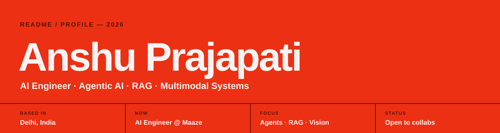

<!-- ═══════════════════════════════ HEADER ═══════════════════════════════ -->

<!-- TODO: replace YOUR_USERNAME, or delete badges you don't need -->

| `00` | Contents |
|:--|:--|
| `01` | [About](#about) · `02` [Impact](#impact) · `03` [Projects](#projects) · `04` [Tech Stack](#stack) · `05` [Achievements](#achievements) · `06` [Stats](#stats) · `07` [Contact](#contact) |

---

<!-- ═══════════════════════════════ ABOUT ═══════════════════════════════ -->

## `01` About Me

I'm an **AI Engineer at Maaze Underwriting Pvt Solutions** in Delhi, building agentic AI that runs in production: voice-calling agents, multi-tenant WhatsApp agents, real-time meeting assistants, RAG over knowledge graphs, and computer vision fused with sensor data.

| | |
|:--|:--|
| **Now** | Scaling voice + WhatsApp agents to 1,000+ concurrent conversations |
| **Exploring** | Pairing vector search with knowledge graphs |
| **Care about** | Guardrails, human-in-the-loop approval, cost and latency |
| **Studying** | B.Sc. Computer Science, IGNOU (CGPA 8.2/10) |
| **Ask me about** | LangGraph, AWS Bedrock, RAG, YOLO, FastAPI |

> **If it doesn't survive real users, real edge cases and real load, it isn't done.**

---

<!-- ═══════════════════════════════ IMPACT ═══════════════════════════════ -->

## `02` Impact at Work

| <h3>1,000+</h3>concurrent agent conversations | <h3>−45%</h3>manual handling time | <h3>+28%</h3>intent-classification accuracy | <h3>−30%</h3>LLM inference cost |
|:---|:---|:---|:---|
| <h3>+20%</h3>retrieval precision | <h3>150+</h3>daily meeting-assistant users | <h3>92%</h3>collision-prediction accuracy | <h3>96% @ 30 FPS</h3>passenger counting |

<b>How these were achieved</b>

 

- **Agents:** autonomous Twilio voice agent + multi-tenant WhatsApp agent on AWS Bedrock and LangGraph
- **Routing:** LLM orchestrator with intent parsing and function calling across rule engines, ML pipelines and agents
- **Cost:** batching, LLM caching and token optimization
- **Retrieval:** Pinecone combined with multi-tenant knowledge graphs (+20% precision, −30% latency)
- **Meetings:** streaming speech-to-text agent joining Teams, Meet and Zoom (92% satisfaction)
- **Perception:** video + g-force/delta-velocity fusion, 10 ms gyroscope detector (98%), YOLOv8x + BoxMOT counting
- **Shipping:** Dockerized FastAPI microservices on Kubernetes with CI/CD and A/B evaluation

---

<!-- ═══════════════════════════════ PROJECTS ═══════════════════════════════ -->

## `03` Featured Projects

#### `A` Agentic AI & Voice

<table>
<tr>
<td width="50%" valign="top">

### [GPS Fleet Voice Agent](https://github.com/anshuu-prajapati/gps-voice-agent)
Places outbound calls to drivers and extracts service needs from Hindi / Hinglish speech with an LLM.

   

</td>
<td width="50%" valign="top">

### [Agentic Outreach Automation](https://github.com/anshuu-prajapati/Email_Automation)
Four-stage agent: find companies → find leads → draft emails → send, with human approval, spend budgets and rate limits.

  

</td>
</tr>
<tr>
<td width="50%" valign="top">

### [Vehicle Support Chatbot](https://github.com/anshuu-prajapati/Vehicle_support_chatbot)
WhatsApp RAG assistant with live vehicle-API tool calls, retries, conversation state and ticket workflows.

   

</td>
<td width="50%" valign="top">

### [WhatsApp GPS Bot](https://github.com/anshuu-prajapati/whatsapp-bot)
Fleet status, service booking and bulk updates, all over WhatsApp.

  

</td>
</tr>
</table>

#### `B` Computer Vision & Multimodal

<table>
<tr>
<td width="50%" valign="top">

### [DocuSentinel](https://github.com/anshuu-prajapati/DocuSentinel) &nbsp;
Screens passports, visas and IDs: OCR + MRZ checksums, tamper forensics and FaceNet matching → one explainable 0–100 risk score in ~2 s.

   

</td>
<td width="50%" valign="top">

### [ClipForge](https://github.com/anshuu-prajapati/clipforge)
Long video → ranked vertical shorts: Whisper word timings → LLM hook scoring → NMS dedup → face-tracked 9:16 with motion captions.

   

</td>
</tr>
<tr>
<td width="50%" valign="top">

### [TransitCount](https://github.com/anshuu-prajapati/TransitCount)
Real-time bus passenger counter on live streams, with a 3-state door counter, staff-vest exemption and Kalman-smoothed tracking.

  

</td>
<td width="50%" valign="top">

### [Deep Person Re-ID](https://github.com/anshuu-prajapati/Deep-person-reid)
Matches the same person across frames and camera streams.

  

</td>
</tr>
</table>

#### `C` Open Source & Fun

<table>
<tr>
<td width="50%" valign="top">

### [YT ASCII Player](https://github.com/anshuu-prajapati/YT-ASCII-PLAYER)
Play any YouTube video as synced, true-colour ASCII art in your terminal. One `pip install ytascii-player`, no ffmpeg setup.

  

</td>
<td width="50%" valign="top">

### [MGNREGA District Dashboard](https://github.com/anshuu-prajapati/MGNREGA-District-Dashboard)
Turns raw government open data into a district-level employment dashboard with auto location detection.

   

</td>
</tr>
</table>

<b>More repositories</b>

 

| Repo | Area |
|:---|:---|
| [Machine-Learning](https://github.com/anshuu-prajapati/Machine-Learning) | Classic ML notebooks and experiments |
| [Customer_agent](https://github.com/anshuu-prajapati/Customer_agent) | Customer support agent |
| [BizpilotAi](https://github.com/anshuu-prajapati/BizpilotAi) | AI business assistant |
| [quickGpt](https://github.com/anshuu-prajapati/quickGpt) | ChatGPT-style web app |
| [Ai-study-tracker](https://github.com/anshuu-prajapati/Ai-study-tracker) | AI study tracker |
| [Prescripto](https://github.com/anshuu-prajapati/Prescripto) · [LMS](https://github.com/anshuu-prajapati/LMS) · [SnapUI](https://github.com/anshuu-prajapati/SnapUI) | Full-stack MERN apps |

→ [See all repositories](https://github.com/anshuu-prajapati?tab=repositories)

---

<!-- ═══════════════════════════════ STACK ═══════════════════════════════ -->

## `04` Tech Stack

| | |
|:---|:---|
| **Languages** |       |
| **ML & Vision** |        |
| **GenAI & Agents** |       |
| **Retrieval** |     |
| **Backend** |       |
| **Data** |     |
| **Infra** |       |

---

<!-- ═══════════════════════════════ ACHIEVEMENTS ═══════════════════════════════ -->

## `05` Achievements & Certifications

| Achievement | Area |
|:---|:---|
| **Smart India Hackathon (SIH)** | AI / Technology |
| **DS2S Hackathon** | AI / Software Engineering |
| **GDG Program Achievement** | Developer Community |
| **AI/ML Certification — Cisco** | Artificial Intelligence / ML |
| **AI/ML Certification — IBM** | Artificial Intelligence / ML |

---

<!-- ═══════════════════════════════ STATS ═══════════════════════════════ -->

## `06` GitHub Stats

---

<!-- ═══════════════════════════════ CONTACT ═══════════════════════════════ -->

## `07` Contact

Open to AI/ML collabs, GenAI and LLM projects, AI Agent work, Voice AI, Computer Vision, and interesting startup ideas.

